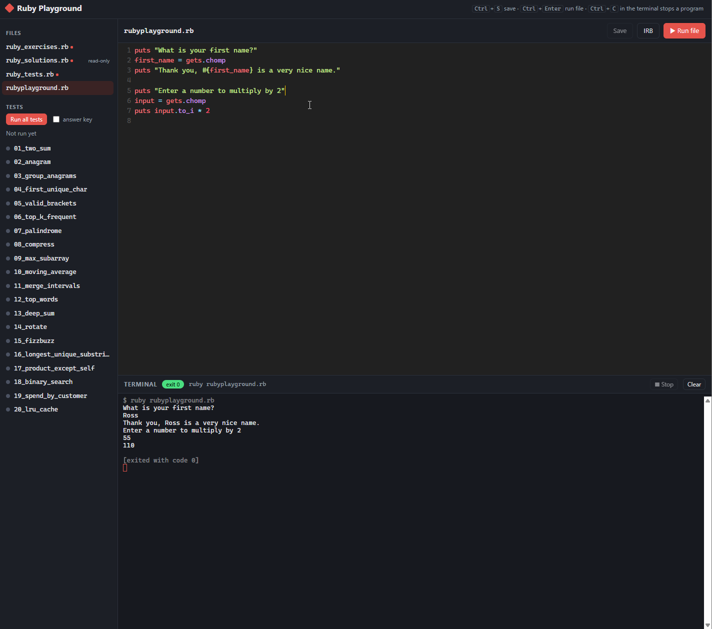

# Ruby Playground

A small space for practising Ruby: interview-style drills with tests, plus a scratch file for trying things out.



## Files

| File                | Purpose                                                           |
| ------------------- | ----------------------------------------------------------------- |
| `rubyplayground.rb` | Scratch file for experimenting                                    |
| `ruby_exercises.rb` | 20 drills to fill in (each starts as `raise NotImplementedError`) |
| `ruby_tests.rb`     | Minitest tests for the drills                                     |
| `ruby_solutions.rb` | Answer key                                                        |

## Requirements

- Ruby 3.x (the files use endless method syntax, which needs Ruby 3.0+)
- Minitest, which ships with Ruby, so there's nothing to install

For development here, Ruby 3.4 was installed in **WSL (Ubuntu 24.04)** through [mise](https://mise.jdx.dev/). So run everything from an Ubuntu terminal.

## Getting started

Open an Ubuntu (WSL) terminal and go to the project folder:

```bash
cd /mnt/c/Users/rtbfl/Projects/ruby/rubyplayground
ruby -v   # should print ruby 3.4.x
```

Tip: running `code .` from this folder opens VS Code connected to WSL, so its built-in terminal can run `ruby` directly.

## Usage

```bash
ruby rubyplayground.rb                  # run the playground (it waits for you to type a name)
ruby ruby_tests.rb                      # test all your exercises
ruby ruby_tests.rb -n /two_sum/         # test one exercise (matches the test name)
SOLUTIONS=1 ruby ruby_tests.rb          # run the tests against the answer key instead
```

## Web UI

There's a small browser UI for editing, running and testing the files, with Ruby syntax highlighting. It needs no gems; the server uses only Ruby's standard library.

```bash
ruby ui/server.rb        # then open http://localhost:4567 in your Windows browser
```

To use another port, run `PORT=8080 ruby ui/server.rb`.

### Stopping the server

- **Started in a terminal:** press `Ctrl+C` in that terminal.
- **Running in the background**, or you've lost the terminal: run this from any Ubuntu terminal:

  ```bash
  pkill -f "[r]uby ui/server.rb"   # the [r] stops the command from matching itself
  ```

To check whether it's still running, use `pgrep -af "[r]uby ui/server.rb"`, which prints nothing when it has stopped.

- **Files:** click a file to open it in the editor. `ruby_solutions.rb` is read-only so the answer key can't be changed by accident. A ● marks unsaved changes.
- **▶ Run file** (`Ctrl+Enter`) runs the open file in the **Terminal** panel. It's a real terminal, so when the program calls `gets` you type the answer there and press Enter, just as in a shell.
- **IRB** starts an interactive IRB session in the terminal. Type `exit` to leave it. To try your exercise methods there, run `load "ruby_exercises.rb"` first.
- **Stopping a program:** press `Ctrl+C` in the terminal, or click **■ Stop**. Starting a new run also stops the previous one.
- **Tests:** **Run all tests**, or click a single test. Each test gets a dot: green for pass, red for fail, orange for error. Tick **answer key** to run the tests against the solutions.
- Running a file or a test saves your changes first. `Ctrl+S` also saves.

The server listens only on `localhost`, and it can only open, save and run the `.rb` files in this folder. Programs run in a pseudo-terminal (Ruby's `pty` library), so the server needs Linux, WSL or macOS. The editor (CodeMirror) and terminal (xterm.js) load from a CDN, so the page needs an internet connection.

## Workflow

1. Pick a drill in `ruby_exercises.rb` and replace `raise NotImplementedError` with your solution.
2. Run that drill's test, for example `ruby ruby_tests.rb -n /anagram/`.
3. When it passes, move on to the next drill. Check `ruby_solutions.rb` afterwards to compare approaches.
